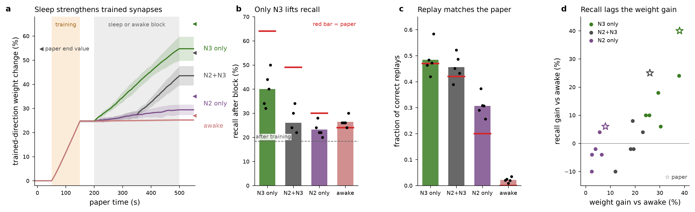

# Wei et al. 2018 reproduction: Fig 2/3 (single sequence, four sleep conditions)

Model: `model/wei2018/` at 62b47c8 (job driver 3a37f9f); see `PROVENANCE.md`,
`docs/wei2018_interpretations.md` and `docs/wei2018_gate.md`.
Runs: 20 (conditions N2+N3, awake, N2 only, N3 only x seeds 0-4), 562 s each
(12 s warm-up + paper t = 0-550 s), Modal cpu=4 / 1 GB, median 9.6 h wall per run.
Registry, per-run scores and criteria: `sweeps/wei2018_fig3/`. Scorer:
`sim/wei2018/score_fig3.py`. Paper values are read off Fig 2E/3B/3C/3E and are approximate.

Design note: runs with the same seed are bit-identical until sleep onset (verified:
identical spike trains before t = 200 s for N3 vs awake, seed 0). The four conditions
are therefore PAIRED by seed, and "sleep minus awake, same seed" isolates the effect of
the 300 s block. With n = 5 the paper's n = 10 power is not reached; p-values are
paired t-tests.

## Results (mean over 5 seeds)

| condition | weight change after training | weight change after block | paper | recall after block | paper | correct-replay fraction | paper |
|---|---|---|---|---|---|---|---|
| N3 only | 24.7 % | **54.7 %** | ~65 % | **40.0 %** | ~64 % | **0.48** | ~0.47 |
| N2+N3 | 24.7 % | **43.5 %** | ~53 % | 26.0 % | ~49 % | **0.46** | ~0.42 |
| N2 only | 24.7 % | **29.4 %** | ~35 % | 23.2 % | ~30 % | **0.31** | ~0.2 |
| awake | 24.7 % | **25.2 %** | ~27 % | 26.4 % | ~24 % | **0.02** | 0 |

Recall before training 15.2 % (paper 13.8 %), after training 18.4 % (paper 22.6 %).

## Criteria

| id | claim | measured | verdict |
|---|---|---|---|
| F3B.train | training potentiates the trained direction by ~25 % | 24.7 +/- 0.2 % | **PASS** |
| F3B.vs-awake | each sleep condition strengthens trained synapses beyond awake (same seed) | N3 +29.5, N2+N3 +18.3, N2 +4.2 points; p = 0.0002 / 0.0005 / 0.007 | **PASS** (all three) |
| F3B.order | N3 > N2+N3 > N2 > awake | 54.7 > 43.5 > 29.4 > 25.2 | **PASS** (paper order exactly; magnitudes ~80 % of paper) |
| F3E.1 | replay higher in every sleep condition than awake | 0.48 / 0.46 / 0.31 vs 0.02 | **PASS** |
| F3E.2 | more replay in N3 than N2 | 1023 vs 131 correct replays | **PASS** |
| F3E.dir | correct-order replay exceeds reversed | N3 1023 vs 117; N2+N3 615 vs 84; N2 131 vs 64 | **PASS** |
| F2E.1 | training raises recall | 15.2 -> 18.4 % (n = 20, p = 0.046) | PASS, weak (paper 13.8 -> 22.6) |
| F3C.n3-vs-awake | N3 raises recall beyond awake | +13.6 +/- 3.2 points, p = 0.014 | **PASS** (paper ~+40) |
| F3C.n2n3-vs-awake | N2+N3 raises recall beyond awake | -0.4 +/- 3.1, p = 0.9 | **FAIL** (paper ~+25) |
| F3C.n2-vs-awake | N2 raises recall beyond awake | -3.2 +/- 2.2, p = 0.23 | **FAIL** (paper ~+6, the paper's own weakest effect, p = 0.017 at n = 10) |
| F3C.awake | no recall change over the awake block | 18.4 -> 26.4 %, p = 0.022 | **FAIL** (paper n.s.) |

## Reading

The synaptic and replay layers reproduce. Training writes the paper's ~25 %; every sleep
condition consolidates beyond awake in the paper's order (N3 > N2+N3 > N2 > awake). Replay
reproduces quantitatively, including no replay in the awake block. These are the
mechanistic claims of the paper.

The behavioural readout (string-match recall) reproduces only for N3, and it is
contaminated by a **test-history effect** absent from the paper. Recall rises over the
awake block with no synaptic change (weights 24.7 -> 25.2 %, recall 18.4 -> 26.4 %), and
within every 50-trial test session recall is higher in the first 25 trials than the last
25 (after training 20.8 -> 16.0 %; after the block 31.8 -> 26.0 %). So recall depends on
time since the last stimulation as well as on weights; the after-training test,
which immediately follows 100 s of training, is depressed. Because all four conditions share
this history, the same-seed contrast against awake is the clean comparison. On it, the
weight gain maps onto recall with a threshold: only N3's +30-point weight gain clears it.

Likely contributors, untested: (i) stimulus amplitude, `input_strength` 1.2 inherited from
the donor (interpretation I8). A drive this strong may recruit the neighbourhood
regardless of weights and compress the dynamic range of the readout. (ii) Slow activity-
dependent currents (KCa, Km) or AMPA_D3 short-term depression carried across trials
1 s apart. (iii) Consolidation magnitudes at ~80 % of the paper's, which leaves N2+N3
below the threshold that N3 clears.

## Not run (deferred by choice)

Fig 5 (strong/weak sequence competition under N3), Fig 7 (spindle protection with 500 s
N2 first) and Fig 4 cluster analysis on sleep epochs. Protocols are ready in
`model/wei2018/protocols/`; at cpu = 4 a Fig 5 run is ~9.6 h and a Fig 7 run ~19 h.

## Compute

20 runs x ~9.6 h x 4 cores ~ 770 core-h for the results above, plus ~410 core-h in a batch
lost to an offline harvest (now prevented by Volume persistence) and ~150 core-h of smoke,
gate and killed runs.
