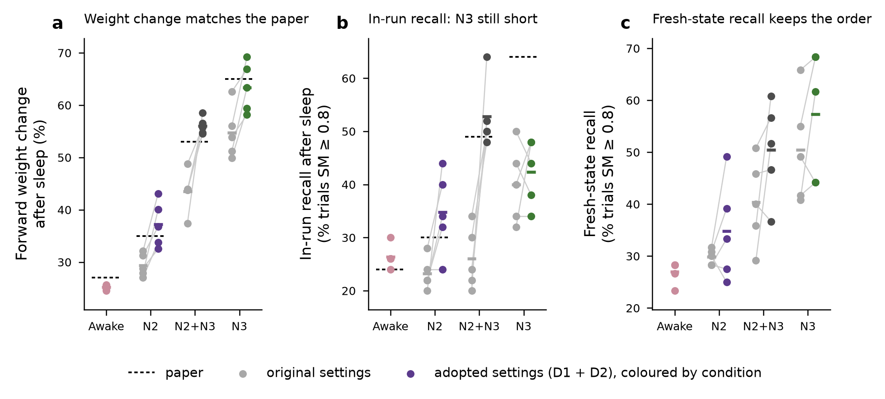

# Wei et al. 2018 reimplementation: Stage 2 summary (fix candidates D1–D5)

Stage 2 tested the candidate causes of the remaining gaps to Wei et al. 2018 Fig 3 identified in `wei2018_code_comparison.md`. Two STDP-schedule changes were adopted; the thalamic and routing alternatives were rejected.

## Adopted settings

| setting | original | adopted | basis |
|---|---|---|---|
| STDP amplitude in N2 (`stdp_factor_n2`) | 0.5 | **1.0** (D1) | Methods halve A± "during slow-wave sleep"; the Introduction defines N3 as slow-wave sleep |
| STDP amplitude in N3 (`stdp_factor_n3`) | 0.5 | **0.75** (D2) | donor code (Gonzalez et al. 2020) value; the paper's Discussion ties the STDP amplitude to ACh level |
| thalamic strengths, Ih shift, TC→cortex AMPA routing | paper values | unchanged | D3/D4 gate runs (`stage2_gate_n2.csv`) gave no clean improvement |

`wei2018_params.txt` still holds 0.5 / 0.5; the adopted values were applied with the CLI flags `-stdp_factor_n2 1 -stdp_factor_n3 0.75`.

## Outcome (5 seeds per condition)

| condition | metric | original | adopted | paper |
|---|---|---|---|---|
| awake | forward Δw (%) | 25.2 | 25.2 (unchanged) | ~27 |
| N2 | forward Δw (%) | 29.4 | **37.3** | ~35 |
| N2+N3 | forward Δw (%) | 43.5 | **56.0** | ~53 |
| N3 | forward Δw (%) | 54.7 | **63.4** | ~65 |
| awake / N2 / N2+N3 / N3 | in-run recall after sleep (%) | 26.4 / 23.2 / 26.0 / 40.0 | 26.4 / 34.8 / 52.8 / **42.4** | ~24 / ~30 / ~49 / ~64 |
| awake / N2 / N2+N3 / N3 | fresh-state recall, SM ≥ 0.8 (%) | 27.0 / 29.8 / 40.3 / 50.5 | 27.0 / 34.8 / 50.5 / 57.3 | — |

- Weight changes now match the paper within 2–3 points in every condition, in the paper's order (N3 > N2+N3 > N2 > awake).
- Fresh-state recall follows the same order. Its gains are smaller than the weight gains and noisy across seeds.
- **Remaining mismatch: in-run recall after N3 alone** (42 % against ~64 %). N3 weights rose by 9 points under D2, yet in-run N3 recall barely moved, and in-run N2+N3 recall (53 %) now exceeds it. The D5 recordings showed that each test response is followed by >0.65 s of network-level quiescence, which caps recall at the 1 s test spacing independently of the weights. The fresh-state test, which avoids this, keeps N3 ahead. This is treated as a property of the test protocol rather than of consolidation.

## D2 details (N3 STDP factor 0.75)

Runs: N3 with `-stdp_factor_n3 0.75`; N2+N3 with `-stdp_factor_n2 1 -stdp_factor_n3 0.75`. Seeds 0–4, followed by the `stage1_curve` fresh-state test from the end-of-block weights. All 10 runs are bit-identical to the original Fig 3 runs before sleep onset (`d2/prefix_checks_d2.csv`).

| condition | metric | original | D1 | D2 | p vs original | p vs D1 | paper |
|---|---|---|---|---|---|---|---|
| N3 | forward Δw (%) | 54.7 | — | 63.4 (sd 4.7) | 0.010 | — | ~65 |
| N3 | in-run recall (%) | 40.0 | — | 42.4 | 0.60 | — | ~64 |
| N3 | fresh-state recall (%) | 50.5 | — | 57.3 | 0.21 | — | — |
| N2+N3 | forward Δw (%) | 43.5 | 48.6 | 56.0 (sd 1.6) | 0.006 | 0.002 | ~53 |
| N2+N3 | in-run recall (%) | 26.0 | 44.8 | 52.8 | 0.006 | 0.034 | ~49 |
| N2+N3 | fresh-state recall (%) | 40.3 | 45.2 | 50.5 | 0.15 | 0.22 | — |

Paired t-tests over seeds, n = 5. D1 details: `wei2018_stage2_d1.md`.

## Other candidates

- **D3 (literal routing of the "AMPA from TC" factor onto TC→PY/IN):** cortex overdriven (PY 7.4 Hz in N2). Rejected.
- **D4 (thalamic loop strength, Ih shift) for the spindle-frequency offset:** no variant gave clean 7–14 Hz spindles; weaker RE→TC GABA gave a 4 Hz thalamic rhythm and a −4 mV Ih shift silenced the thalamus. Kept the paper's values; both are noted as levers for the SWD phase.
- **D5 (1 s vs 3 s test spacing):** explained by post-response network quiescence, not synaptic depression (one seed).

## Compute

D2: 5 Modal jobs (cpu 8, 2 runs × 4 threads), wall 31.0–62.4 ks per job (about 500 core-h in total). Wall time varied ~2× between identical jobs because of host differences on Modal.

## Files

`sweeps/wei2018_stage2/`: `stage2_summary_table.csv`, `wei2018_stage2_summary.png`, `d1/`, `d2/` (`d2_contrasts.csv`, `fig3_paired_d2.csv`, `recall_paired_d2.csv`, `prefix_checks_d2.csv`, `stage1_trials_d2.csv`), `stage2_gate_n2.csv`. Scripts: `sim/wei2018/score_d1.py`, `score_d2.py`, `plot_d1.py`, `plot_stage2.py`. Run files: Modal Volume `wei2018-runs:/stage2` (D2 runs `fig3_n3_s*_f6a2a6`, `fig3_n2n3_s*_f84d82`, `stage1_curve_{n3,n2n3}d2_s*_block_5cd94d`).
