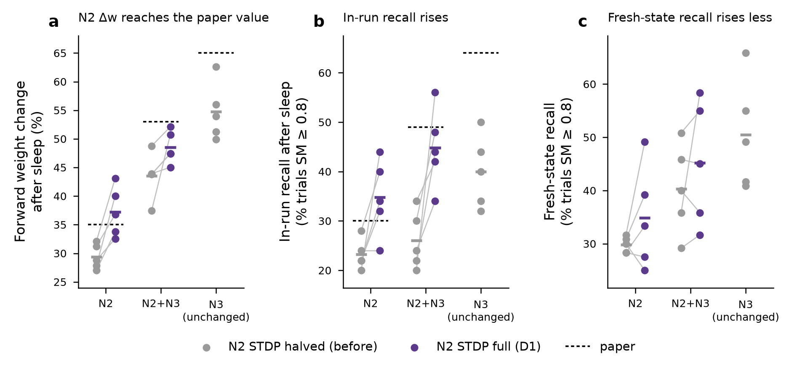

# Wei et al. 2018 reimplementation: Stage 2, D1 (full STDP in N2), 5 seeds

## Change tested (D1)

The paper's Introduction defines N3 as "slow wave sleep", so the halving of the STDP rate during slow-wave sleep should apply to N3 only. Our earlier runs (interpretation I2) also halved it in N2. D1 reruns the N2-only and N2+N3 Fig 3 protocols with `-stdp_factor_n2 1`. Everything else, including N3 (factor 0.5), is unchanged.

## Checks

- For all 10 runs (2 conditions × seeds 0–4), spikes and every weight snapshot before sleep onset (t < 212 s) are bit-identical to the original Fig 3 runs (`prefix_checks.csv`). The change acts only during sleep.
- Fresh-state recall tests use the end-of-block weights (t = 512 s) and the Stage 1 `stage1_curve` protocol: 120 trials at 4 amplitudes, scored with `score_stage1.py`.

## Results (mean of 5 seeds; paired against the same seeds with N2 STDP halved)

| condition | metric | before (N2 halved) | D1 (N2 full) | Δ (paired) | p (paired t, n = 5) | paper |
|---|---|---|---|---|---|---|
| N2 | forward Δw after sleep (%) | 29.4 | **37.3** (sd 4.4) | +7.8 | 0.008 | ~35 |
| N2 | in-run recall after sleep (%) | 23.2 | 34.8 | +11.6 | 0.038 | ~30 |
| N2 | fresh-state recall, SM ≥ 0.8 (%) | 29.8 | 34.8 | +5.0 | 0.27 | — |
| N2+N3 | forward Δw after sleep (%) | 43.5 | **48.6** (sd 2.8) | +5.0 | 0.079 | ~53 |
| N2+N3 | in-run recall after sleep (%) | 26.0 | 44.8 | +18.8 | 0.020 | ~49 |
| N2+N3 | fresh-state recall, SM ≥ 0.8 (%) | 40.3 | 45.2 | +4.8 | 0.36 | — |
| N3 (unchanged) | forward Δw / in-run / fresh-state | 54.7 / 40.0 / 50.5 | — | — | — | ~65 / ~64 / — |

## Reading

1. **N2 weight change now matches the paper.** 37.3 % against the paper's ~35 % and the 34 % predicted from the code comparison. Seeds range from 32.6 to 43.1 %.
2. **N2+N3 closes about half of its gap.** 48.6 % against ~53 % (before: 43.5 %). The remaining ~4 points sit in the N3 half of the block, which D1 does not touch. N3 itself is ~10 points short of the paper (54.7 against ~65).
3. **Ordering.** Δw keeps the paper's order, N3 > N2+N3 > N2, and so does fresh-state recall (50.5 > 45.2 > 34.8; awake 27.0). In-run recall now puts N2+N3 (44.8) above N3 (40.0), whereas the paper has N3 well ahead (~64). In-run tests are the paper's own measure, but they carry the post-response quiescence confound identified under D5, so the fresh-state order is the more reliable one here.
4. **In-run recall rises by much more than fresh-state recall** (+12 to +19 points against +5). The in-run test follows directly on sleep, so part of the in-run gain may reflect the network state at the end of sleep rather than the weights. Fresh-state gains are not significant at n = 5; two N2 seeds (3, 4) score slightly lower despite higher Δw.

## Decision

D1 is adopted: STDP is halved in N3 only. The remaining gap is in N3, so D2 (N3 STDP factor 0.75, as in the donor code) is being run for N3 and N2+N3 (with D1), 5 seeds.

## Files

`sweeps/wei2018_stage2/d1/`: `d1_contrasts.csv`, `fig3_paired.csv`, `recall_paired.csv`, `prefix_checks.csv`, `stage1_trials_f1.csv`, `wei2018_stage2_d1.png`. Scoring: `sim/wei2018/score_d1.py`; figure: `sim/wei2018/plot_d1.py`. Run files: Modal Volume `wei2018-runs:/stage2` (`fig3_{n2,n2n3}_s{0..4}_8c6045`, `stage1_curve_{n2,n2n3}f1_s{0..4}_block_5cd94d`).
