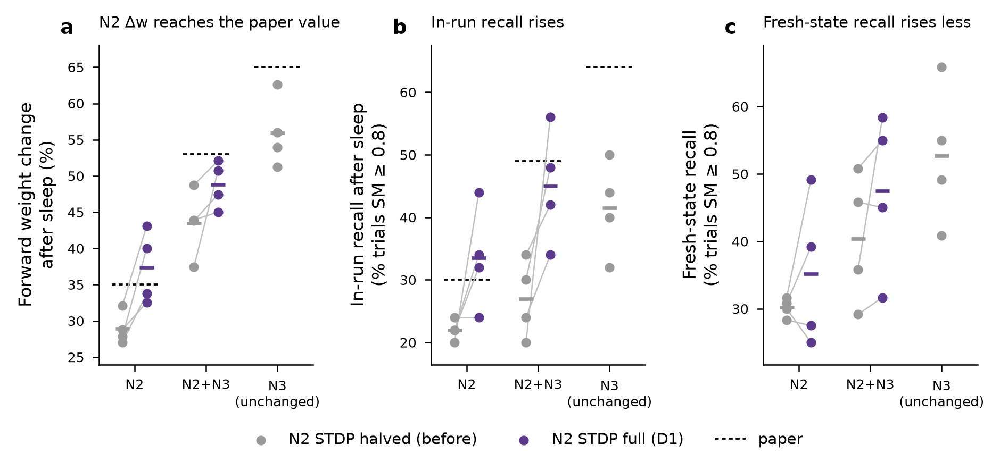

# Wei et al. 2018 reimplementation: Stage 2, D1 (full STDP in N2) — provisional, seeds 1–4

**Status: provisional.** Seed 0 is still running; this note will be replaced by `wei2018_stage2.md` once it lands.

## Change tested (D1)

The paper's Introduction defines N3 as "slow wave sleep", so the halving of the STDP rate during slow-wave sleep should apply to N3 only. Our earlier runs (interpretation I2) also halved it in N2. D1 reruns the N2-only and N2+N3 Fig 3 protocols with `-stdp_factor_n2 1`; everything else, including N3 (factor 0.5), is unchanged.

## Checks

- For all 8 runs (2 conditions × seeds 1–4), spikes and every weight snapshot before sleep onset (t < 212 s) are bit-identical to the original Fig 3 runs (`prefix_checks.csv`). The change therefore acts only during sleep.
- Fresh-state recall tests use the end-of-block weights (t = 512 s) and the Stage 1 `stage1_curve` protocol: 120 trials at 4 amplitudes, scored with `score_stage1.py`.

## Results (mean of seeds 1–4; paired against the same seeds with N2 STDP halved)

| condition | metric | before (N2 halved) | D1 (N2 full) | Δ (paired) | p (paired t, n = 4) | paper |
|---|---|---|---|---|---|---|
| N2 | forward Δw after sleep (%) | 29.0 | **37.4** (sd 5.0) | +8.4 | 0.022 | ~35 |
| N2 | in-run recall after sleep (%) | 22.0 | 33.5 | +11.5 | 0.10 | ~30 |
| N2 | fresh-state recall, SM ≥ 0.8 (%) | 30.2 | 35.2 | +5.0 | 0.39 | — |
| N2+N3 | forward Δw after sleep (%) | 43.5 | **48.8** (sd 3.2) | +5.4 | 0.14 | ~53 |
| N2+N3 | in-run recall after sleep (%) | 27.0 | 45.0 | +18.0 | 0.07 | ~49 |
| N2+N3 | fresh-state recall, SM ≥ 0.8 (%) | 40.4 | 47.5 | +7.1 | 0.27 | — |
| N3 (unchanged, seeds 1–4) | forward Δw / in-run / fresh | 55.9 / 41.5 / 52.7 | — | — | — | ~65 / ~64 / — |

## Reading

1. **N2 weight change now matches the paper.** 37.4 % against the paper's ~35 % and the 34 % predicted from the code comparison. The seed spread is large: seeds 1–2 reach 40–43 %, seeds 3–4 reach 33–34 %.
2. **N2+N3 closes about half of its gap.** 48.8 % against ~53 % (before: 43.5 %). The remaining ~4 points sit in the N3 half of the block, which D1 does not touch. N3 itself is still ~9 points short of the paper (55.9 against ~65).
3. **Ordering.** Δw keeps the paper's order, N3 > N2+N3 > N2. In fresh-state recall the order also holds (52.7 > 47.5 > 35.2). For in-run recall, N2+N3 (45.0) now exceeds N3 (41.5), whereas the paper has N3 well ahead (~64). In-run tests are the paper's own measure, but they carry the post-response quiescence confound identified under D5, so the fresh-state order is the more reliable one here.
4. **Recall gains are smaller and noisier than the weight gains.** Fresh-state recall rises by 5–7 points, not significant at n = 4. Two N2 seeds (3, 4) show lower fresh-state recall despite higher Δw.

## Implication for D2

D1 removes the N2 discrepancy. The gap that remains is in N3 (Δw ~56 against ~65), and it propagates into N2+N3. D2 (N3 STDP factor 0.75, as in the donor code) is the remaining candidate that targets it; it would change N3 and N2+N3 but leave N2 as it is now.

## Files

`sweeps/wei2018_stage2/d1/`: `d1_provisional_contrasts.csv`, `fig3_paired.csv`, `recall_paired.csv`, `prefix_checks.csv`, `stage1_trials_f1.csv`, `wei2018_stage2_d1_provisional.png`. Scoring: `sim/wei2018/score_d1.py`. Run files: Modal Volume `wei2018-runs:/stage2` (`fig3_{n2,n2n3}_s{1..4}_8c6045`, `stage1_curve_{n2,n2n3}f1_s{1..4}_block_5cd94d`).
